<picture>
  <source media="(max-width: 700px)" srcset="assets/header.svg">
  
</picture>

*Construyendo productos reales*

## Sobre mí

Estudiante de Ingeniería de Sistemas. Me gusta que lo que construyo llegue a producción, con el código tipado y probado antes de publicarlo.

<picture>
  <source media="(max-width: 700px)" srcset="assets/section-column.svg">
  
</picture>

**Herramientas**

Discord&nbsp;Party&nbsp;Hub: [Demo](https://discord-party-hub.vercel.app) · [Frontend](https://github.com/juankio/discord-party-hub) · [Backend](https://github.com/juankio/discord-party-hub-backend) | Cine&nbsp;al&nbsp;Parque: [Demo](https://cine-parque.vercel.app) · [Repositorio](https://github.com/juankio/cine-al-parque-) | Contabilidad: [Demo](https://contabilidad-seven.vercel.app) · [Repositorio](https://github.com/juankio/contabilidad) | Simulador&nbsp;ESP32: [Demo](https://simulador-esp32.vercel.app) · [Repositorio](https://github.com/juankio/simulador-esp32)

<picture>
  <source media="(max-width: 700px)" srcset="assets/section-stats.svg">
  
</picture>

<picture>
  <source media="(max-width: 700px)" srcset="assets/section-contact.svg">
  
</picture>

<picture>
  <source media="(max-width: 700px)" srcset="assets/footer.svg">
  
</picture>

