Tecnólogo en Desarrollo de Software · Estudiante de Ingeniería de Sistemas · Colombia

*Construyendo productos web reales*

## Sobre mí

- Tecnólogo en Desarrollo de Software y estudiante de Ingeniería de Sistemas.
- Fullstack: interfaces con Nuxt 3 y Vue 3, APIs con NestJS, datos con MongoDB.
- Proyectos desplegados: un juego multijugador en tiempo real, una plataforma de reservas y un sistema de gestión contable.
- Base: Colombia.

**Frontend**

**Backend y datos**

**Herramientas**

- **Discord Party Hub:** [Demo](https://discord-party-hub.vercel.app) · [Frontend](https://github.com/juankio/discord-party-hub) · [Backend](https://github.com/juankio/discord-party-hub-backend)
- **Cine al Parque:** [Demo](https://cine-parque.vercel.app) · [Repositorio](https://github.com/juankio/cine-al-parque-)
- **Contabilidad:** [Demo](https://contabilidad-seven.vercel.app) · [Repositorio](https://github.com/juankio/contabilidad)
- **Simulador ESP32:** [Demo](https://simulador-esp32.vercel.app) · [Repositorio](https://github.com/juankio/simulador-esp32)

